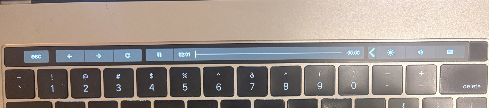

# PenguinBar

An app-aware Touch Bar for Linux for the 2016 and 2017 MacBook Pro.



## What it does

- Keys change with the focused window.

- The Control Strip expands over the app's keys to allow for more controls, like macOS.

- Holding and sliding on buttons on the Control Strip brings up a slider to adjust their values, like macOS.

Apps currently supported:

Spotify

Firefox

kitty

## Requirements

- A T1 MacBook Pro (2016 or 2017) running the [appletbdrm](https://github.com/sunplex07/appletbdrm) driver
- Hyprland
- `brightnessctl`, `wpctl` and JetBrainsMono Nerd Font

## Install

```sh
cargo install --path .
sudo cp packaging/71-penguinbar.rules /etc/udev/rules.d/
sudo usermod -aG video "$USER"   # then log in again
penguinbar run
```

To change the layouts, copy `examples/penguinbar.toml` to `~/.config/penguinbar/penguinbar.toml` and edit it.

## Credits

Built on [sunplex07/appletbdrm](https://github.com/sunplex07/appletbdrm). MIT licensed.
